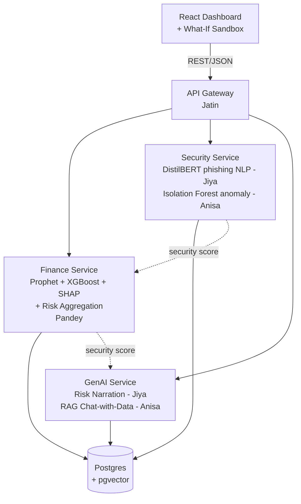

# DecisionIQ - System Architecture & Project Plan

*Final-year project, Group 3. Draft v3, finance module reworked for transaction-only data.*

---

## 1. What you're actually building

A dashboard where an SME connects its login/security logs and financial transactions and gets back one thing: **a business health score, with an explanation, that you can poke at.**

Three moving parts do the work:
- **Security Agent** - flags phishing text and weird login behaviour.
- **Finance Agent** - forecasts cash flow and flags cash-crunch risk.
- **Explainable GenAI Layer** - combines both into one score, explains *why* (SHAP), and narrates it in plain English (Gemini).

The **What-If Sandbox** lets a user drag a slider (e.g. "vendor expenses +15%") and watch the forecast, risk score, and explanation update live.

---

## 2. The constraint that actually drives this architecture

You said it yourselves: 4 freshers, placement season eating your time, building mostly with AI coding assistants working somewhat independently, and a real fear of one person's AI agent stepping on another's code.

That last point matters more than any textbook microservices vs. monolith debate. **The #1 design goal here is: minimize the number of files two different people (or their AI copilots) ever need to touch on the same day.**

That single goal is what decides almost every choice below - not "what's more scalable" or "what's more impressive," because at 4 members and a few weeks, coordination overhead will kill you faster than a suboptimal stack choice will.

So: **separate, small, independently-deployable services - one repo per owner, talking over plain REST/JSON.** Not a tangled monolith (too much shared-file risk), not "real" microservices with message queues/service mesh (too much infra for freshers on a deadline - that's not what get you marks in a final-year demo anyway).

This is basically the hackathon pattern: own your box completely, agree on the interface between boxes *once*, then work in parallel and only touch the integration point at the end.

---

## 3. High-level architecture



Notes on this diagram:
- The frontend **never talks to a service directly** - everything goes through the Gateway. This means the Gateway is the only place that needs to know all four service URLs, and if a service is down/slow, the frontend has one place to handle it.
- The dotted arrows are the aggregation step: Finance Service pulls the latest security score and combines it with its own into one composite number (see §6). This keeps the "Risk Aggregation Engine" from the original slide inside Finance Service, since Pandey owns both - no reason to make it a 6th deployable thing.
- Postgres is shared, but **each service only touches its own tables** (enforced by convention, not hard DB-level isolation - fine at this scale).

---

## 4. Repos and ownership

| Repo | Owner(s) | Why it's isolated this way |
|---|---|---|
| `decisioniq-frontend` | Shared, but componentized (see §9) | Everyone touches the UI eventually - isolation happens at the component-file level, not the repo level |
| `decisioniq-gateway` | Jatin | Routing, env config, health checks, deployment scripts |
| `decisioniq-finance-service` | Pandey | Prophet, XGBoost, SHAP, Risk Aggregation Engine |
| `decisioniq-security-service` | Jiya (`/nlp` folder) + Anisa (`/anomaly` folder) | Two people, two folders, two model files - never the same file |
| `decisioniq-genai-service` | Jiya (`/summarizer` folder) + Anisa (`/rag_chat` folder) | Same pattern - split by folder, not shared files |

Five repos, not one. On GitHub this costs nothing and means nobody's AI agent can `git push` over someone else's work by accident - that risk only exists *within* a repo, so keeping repos separate is a stronger guarantee than "please be careful with branches."

---

## 5. Component deep-dive

### 5.1 Frontend (React + Recharts)
Keep it to four dumb, independent panels composed by one thin `Dashboard.jsx`:
```
frontend/
  src/
    components/
      SecurityPanel.jsx     
      FinancePanel.jsx      
      RiskSummaryPanel.jsx   (GenAI narration + overall score)
      WhatIfSandbox.jsx      (sliders → calls /simulate)
      ChatPanel.jsx           (RAG chat)
    Dashboard.jsx            (just imports + lays out the above)
    api/client.js            (all fetch calls, one file, one source of truth)
```
Each panel only calls its matching Gateway endpoint. Nobody edits `Dashboard.jsx` except whoever's currently wiring up layout - keep that to short, quick edits.

### 5.2 API Gateway (Jatin - FastAPI recommended)
Thin by design. Its job is:
- Route `/finance/*` → finance-service, `/security/*` → security-service, `/genai/*` → genai-service
- Own the `/simulate` endpoint for What-If (orchestrates a call to finance-service, waits for the result, forwards to genai-service, returns combined JSON - see §7)
- CORS, basic auth/API-key if you bother with login, health checks (`/health` on every service, gateway pings all of them so you can see what's down 10 seconds before your demo)
- Hold every service's base URL as env vars - this is the *only* place that needs to know where things live, which is exactly the DevOps ownership you already have

Don't put business logic here. If you're tempted to compute a risk score in the gateway, it belongs in finance-service instead.

### 5.3 Finance Service (Pandey, Python/FastAPI)

**The data constraint that shapes everything here:** DecisionIQ only receives the company's **transaction records**. We never see a bank balance, account access, or "how much money they have." So every finance metric has to be derived from **flows** (money in, money out, and when), never from a balance. Anything that would need a balance is either reframed as a flow-based metric or left out.

The question this service answers, using flows only:

> "Based on this company's transactions, will money going out outpace money coming in over the next 90 days, and how big a cushion would the business need to get through it?"

That is also how profit and cash get separated: a business can look profitable over the last few months and still hit a stretch where payments leave before customer money arrives. Timing is the whole story, and timing is visible in transactions.

**Minimum transaction schema** (freeze this in your contracts doc, it decides which features are possible):
```
required: txn_id, business_id, date, amount, direction (credit | debit), category, counterparty
optional: invoice_id, due_date, status   (unlocks receivable/payable delay features)
```

What the service produces:
- **Flow dashboard data:** income vs. expenses, net flow per month, top categories, trend. Pure aggregation of `finance_transactions`, no ML.
- **Recurring obligation detection:** a rule-based scan for outflows that repeat at regular intervals (salaries, rent, loan EMIs, subscriptions) to project the next due dates and amounts. No ML needed, and it feeds the forecast.
- **Prophet:** 90-day forecast of inflows and outflows, turned into a **projected cumulative net flow curve that starts at zero today**. It shows change relative to today, not a balance.
- **Peak funding gap:** the lowest point of that cumulative curve and the day it happens. It reads as "over the next 90 days this business will need at least X of cushion beyond today." The owner compares that against their own balance, which we never see. This replaces "cash runway" from the earlier draft, which needed a balance.
- **Inflow coverage ratio:** expected inflows divided by expected outflows over the next 30 days. Below 1.0 means pressure.
- **XGBoost:** cash-crunch risk classifier. Features are engineered from trailing transaction windows (outflow to inflow ratio, inflow volatility, gaps between large inflows, share of outflows that are recurring, largest single outflow vs. typical, payment delay trend if due dates exist). The label comes from history: in the following 30 days, did cumulative net flow fall below a set deficit threshold (for example, more than one month of average outflows)? That label definition is the weakest link in the whole model, so decide and document it early.
- **Profit vs. cash warning:** a simple rule on top of the outputs above, not a separate model. If trailing net flow is positive but the forecast shows a deficit dip or coverage below 1.0, set `"profitable_but_cash_tight": true`. Note this is a cash-basis proxy for profit (income minus expenses from transactions), not accounting profit, since we have no accruals.
- **SHAP:** wraps the XGBoost model and returns top-N contributing features as JSON (rising vendor spend, widening gaps between customer payments, a large upcoming outflow). Gemini turns this into English later.
- **Optional balance input, What-If only:** the user may type an assumed balance into the sandbox to see a runway estimate for that scenario. Never required, never stored, hidden by default. This is a team decision: include it as a convenience or drop it to keep the "we never see balances" story clean.
- **Risk Aggregation Engine:** pulls the current security score (one HTTP call to security-service) and combines it with the finance risk score into a single weighted "business health score." A simple weighted average is fine for a final-year project. Document your weights.

**Finance Service response shape** (freeze this in your contracts doc):
```json
{
  "income_vs_expenses": {"income": 340000, "expenses": 298000, "net_flow": 42000},
  "monthly_net_flow": [{"month": "2026-08", "net_flow": 15000}],
  "upcoming_obligations": [{"label": "Salaries", "amount": 90000, "expected_in_days": 6}],
  "forecast_90d": [/* per day or week: date, inflow, outflow, cumulative_net_flow */],
  "peak_funding_gap": 84000,
  "peak_gap_day": 38,
  "inflow_coverage_30d": 0.82,
  "cash_crunch_risk": 0.72,
  "profitable_but_cash_tight": true,
  "shap_features": [{"feature": "widening_customer_payment_gaps", "impact": 0.31}],
  "security_score": 0.18,
  "composite_score": 0.55
}
```

### 5.4 Security Service (Jiya + Anisa - Python/FastAPI)
- `nlp/` (Jiya) - DistilBERT fine-tuned or zero-shot for phishing email/text classification
- `anomaly/` (Anisa) - Isolation Forest over login metadata (time, location, device, frequency) for anomaly scoring
- Both expose their own route (`/nlp/classify`, `/anomaly/score`) and a combined `/security/score` that the finance-service's aggregator calls

### 5.5 GenAI Service (Jiya + Anisa - Python/FastAPI)
- `summarizer/` (Jiya) - takes the aggregated score + SHAP JSON + security findings, prompts Gemini, returns a plain-English risk summary + recommendations
- `rag_chat/` (Anisa) - embeds the business's own data (transactions, security events) into pgvector, retrieves relevant chunks per user question, prompts Gemini for a grounded answer

---

## 6. Request lifecycle: a normal dashboard load

1. Frontend calls `GET /finance/summary` and `GET /security/summary` on load (parallel, via Gateway)
2. Finance Service internally calls Security Service for the latest score, computes the composite, returns `{forecast, risk_score, security_score, composite_score, shap_features}`
3. Frontend sends that payload to `GET /genai/narrate` (via Gateway) for the plain-English summary
4. Dashboard renders: charts (Recharts, from the raw numbers) + narration card (GenAI text) + security/finance breakdown panels

## 7. Request lifecycle: What-If Sandbox

1. User drags a slider (sales -10%, vendor expenses +15%, customers pay 15 days later, opex -10%, hire N more employees) → frontend calls `POST /gateway/simulate` with `{scenario_type, delta}`
2. Gateway forwards the modified params to Finance Service - **no DB write**, this is a pure recompute
3. Finance Service applies the scenario to the transaction series (scale inflows, scale one category's outflows, shift inflow dates by N days, or add a recurring payroll outflow for new hires), re-runs Prophet/XGBoost, and recomputes the peak funding gap, coverage ratio, the profit-vs-cash flag, and SHAP. The composite score reuses the *existing* security score, since a financial what-if does not need security re-run.
4. Gateway forwards the new numbers to GenAI Service for a fresh narration
5. Gateway returns everything in one response; frontend updates charts + narration together and shows the chain clearly: **net cash flow curve and peak funding gap → cash-crunch risk → overall business health**, so the user sees the scenario's effect propagate through all three, not just one changed number

This is also your product's overall pitch in one line - worth keeping visible in the UI copy and your presentation: **Monitor → Forecast → Detect Risk → Explain Why → What-If Simulation → Suggested Actions.**

Keep this synchronous end-to-end. A message queue or async job here is solving a scaling problem you don't have yet - it'll just cost you setup time you don't have either.

---

## 8. Database sketch (Postgres + pgvector on Render)

```
businesses            (id, name, industry, created_at)
finance_transactions  (id, business_id, date, amount, direction, category, counterparty, invoice_id?, due_date?, status?)
security_events       (id, business_id, timestamp, event_type, raw_text, metadata jsonb)
risk_scores           (id, business_id, timestamp, finance_score, security_score, composite_score, peak_funding_gap, inflow_coverage_30d, profitable_but_cash_tight bool, shap_json)
narrations            (id, risk_score_id, summary_text, recommendations_text, created_at)
embeddings            (id, business_id, source_table, source_id, embedding vector(768), chunk_text)
```

`embeddings` backs the RAG chat (pgvector extension - Render's managed Postgres supports it, so you avoid standing up a separate vector DB like Chroma/Pinecone). Each service only writes to its own tables; `risk_scores` and `narrations` are the only tables two services (finance + genai) both touch - keep the schema for those frozen once agreed (see §9).

---

## 9. Rules that actually prevent the "AI agents overwrite each other" problem

1. **Freeze your API contracts on day one**, before anyone writes a model. A shared `docs/api-contracts.md` (or an OpenAPI YAML) listing every endpoint, request shape, and response shape across all 5 repos. Once frozen, changing a contract requires a 2-line message to the group, not a silent edit.
2. **One repo, one primary owner.** When two people share a repo (security-service, genai-service), split by folder on day one and never let one person's AI touch the other's folder - including "small fixes."
3. **Feed your AI copilot the contract, not the whole codebase.** When you ask Copilot/Codex to build finance-service, paste the frozen request/response shape it needs to honor. This stops it from silently inventing a different JSON shape than what the gateway expects.
4. **Mock before you integrate.** Each service should have a `/health` endpoint and a hardcoded example response from day one, so the frontend and gateway can be built against realistic fake data while the ML people are still training models. Nobody should be blocked waiting on someone else's model to finish.
5. **Small, frequent commits per repo**, not one giant end-of-week merge. Since repos are separate, this is low-risk - do it anyway, it makes it obvious who broke what and when.

---

## 10. Tech stack summary

| Layer | Choice | Notes |
|---|---|---|
| Frontend | React (Vite) + Recharts | No Next.js - you don't need SSR/routing complexity for a dashboard |
| Gateway | FastAPI | Keeps the whole backend in one language across all 4 members - easier for AI copilots to stay consistent, easier for you all to read each other's code |
| Finance Service | FastAPI + Prophet + XGBoost + SHAP | |
| Security Service | FastAPI + DistilBERT (HuggingFace) + scikit-learn (Isolation Forest) | |
| GenAI Service | FastAPI + Gemini API + pgvector (via `psycopg2`/`sqlalchemy`) | |
| Database | Render-managed Postgres + pgvector extension | One DB instance, schema-per-service discipline |
| Deployment | Render (5 Web Services + 1 Postgres) | See §11 |

Unifying everyone onto FastAPI (instead of keeping Spring Boot/MERN preferences) is deliberate - it's the biggest single thing that reduces coordination cost, since every AI copilot session across the team is now working against the same conventions, and any of you can read/debug any service if someone's stuck near a deadline.

---

## 11. Deployment on Render

- 5 **Web Services**, one per repo, each pointed at its own GitHub repo (Render's free tier: one repo → one service, so separate repos map cleanly, no monorepo root-directory config needed)
- 1 **Postgres** instance (Render's free Postgres, pgvector enabled), connection string shared via env vars across all services that need it
- Gateway's env vars hold the other 3 services' Render URLs
- **Known gotcha:** Render free-tier services spin down after inactivity and take ~30-50s to wake on the first request. Before your demo/review, hit every service's `/health` endpoint a few minutes ahead of time so nothing is cold when you're presenting live.

---

## 12. Suggested phases

| Phase | Duration | Deliverable |
|---|---|---|
| **0 - Contracts & scaffolding** | ~1 week | API contracts doc frozen, all 5 repos created with `/health` + hardcoded mock responses, Render deployment skeleton live (even returning fake data) |
| **1 - Core ML in isolation** | ~2 weeks | Each ML piece works standalone in a notebook/script: DistilBERT classifying sample phishing text, Isolation Forest scoring sample logins, Prophet forecasting sample transactions, XGBoost classifying sample risk - no service wiring yet |
| **2 - Wrap models as services** | ~1-1.5 weeks | Each notebook becomes a real FastAPI endpoint matching the frozen contract; SHAP wired into XGBoost output |
| **3 - Integration** | ~1 week | Gateway routes real (not mocked) calls end-to-end; frontend swaps from mock data to live Gateway calls; Risk Aggregation Engine combines real scores |
| **4 - GenAI layer + What-If Sandbox** | ~1-1.5 weeks | Gemini narration wired to real SHAP + score output; RAG chat working against real embedded data; What-If sliders trigger the full `/simulate` chain |
| **5 - Polish, test, demo prep** | ~1 week | Dashboard styling pass, a few realistic seed businesses for the demo, health-check-everything before review, slides updated to match what's actually built |

Total: roughly **7-9 weeks**, compressible - Phases 1 and 2 for different services run in parallel across the 4 of you, they're not sequential for the team even though they're sequential per person.

---

## 13. Risks worth naming now

| Risk | Mitigation |
|---|---|
| Model training takes longer than expected (esp. DistilBERT fine-tuning) | Use a pretrained/zero-shot phishing classifier or a smaller model if you're short on time - a working simple model beats an unfinished sophisticated one for a demo |
| Gemini API quota/rate limits during live demo | Cache/pre-generate narrations for your demo businesses as a fallback |
| Render free-tier cold starts embarrass you mid-presentation | Warm up all services a few minutes before presenting (§11) |
| SHAP output isn't actually readable/useful for Gemini to narrate | Test the SHAP → Gemini prompt early (Phase 2), not last minute - this is the "explainability" selling point of the whole project |
| Two people's AI agents still collide despite separate repos (e.g. within security-service's shared folder boundary) | Keep the folder split literal - Jiya never opens `anomaly/`, Anisa never opens `nlp/`, even for "quick fixes" |

---

*This is a first pass based on the current slide deck and your team's constraints - treat the contracts in §9 as the thing to lock down first, everything else can flex.*